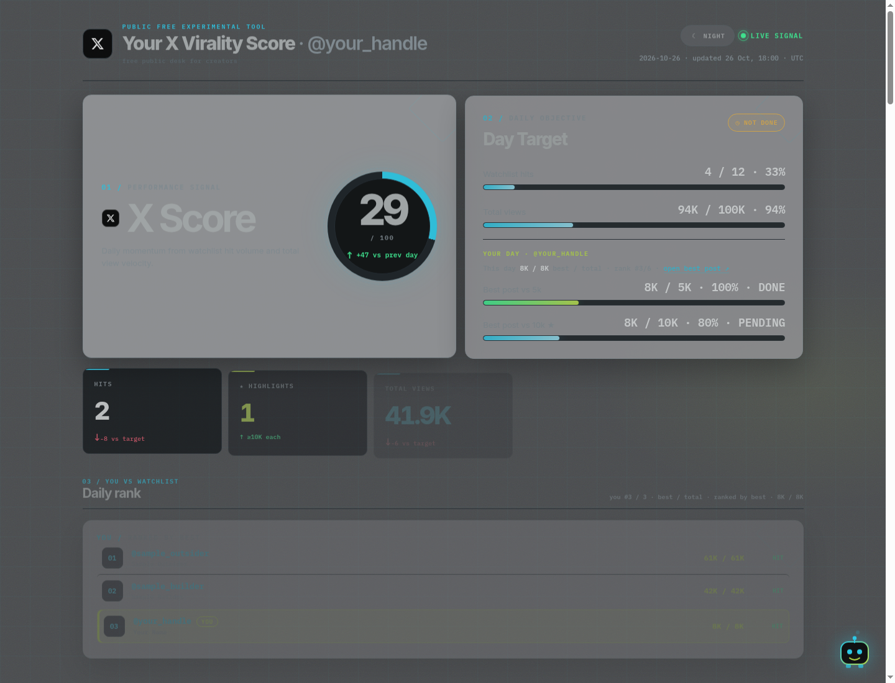

# X Virality Score

A daily X (Twitter) digest and a static board you host yourself. You pick your handle and a watchlist of peers. Each morning you get yesterday's originals that cleared your view floor, the keywords moving on X, rewrite drafts for the top posts, and post ideas. You stay the publisher. Nothing posts, likes, or replies on its own.



## Who it is for

Creators, indie hackers, and operators who want a niche digest without scrolling for it. You bring an X handle, about 15 to 30 peer accounts, and a GitHub account for the board. The desk works for AI tools, crypto, SaaS, marketing, or any other niche. The sample keywords in the starter file are an AI example. Swap them.

## What you get each day

- Watchlist originals from yesterday at or above your view floor (starter: 5,000 views, star at 10,000). Self-quotes count and only get a badge.
- Ranked keywords from the last 24 hours, plus a sampled X keyword table (last 24h vs the previous 24h).
- Rewrite drafts for the **top 10** posts on the board, in your voice, same facts, no new numbers.
- Five to eight post ideas (each with a visual) and two or three article ideas.
- An optional experiment: your own trend posts vs non-trend posts, compared inside the same format.
- A short ping you can read before noon, and a GitHub Pages board with **X Score** and **Day Target** (DONE / NOT DONE).

Big aggregator accounts can feed keywords only. Put them in `trend_input_only` and they never show up as hits, leaderboard rows, or drafts.

## 5-minute Quickstart

You need Python 3. This sample does not call X and does not use your accounts. The posts are fictional, so a fresh clone can run the whole pipeline.

```bash
git clone https://github.com/monkeyteamvip/x-virality-score.git
cd x-virality-score
bash scripts/smoke_day.sh
cd board/.smoke-preview && python3 -m http.server 8765
```

Open `http://127.0.0.1:8765/`. You should see **@your_handle**, an X Score, a Day Target, English drafts, and a printed ping in the terminal that starts with `X digest`. Stop the server with Ctrl-C.

That preview is throwaway. Your real board uses your handle.

## Make it yours

Full steps, including GitHub Pages, the daily routine, the Grok Bot, and running without the bot: **[docs/SETUP.md](docs/SETUP.md)**.

| Next | What it covers |
| --- | --- |
| [docs/SETUP.md](docs/SETUP.md) | Fork or template, Pages, your handle, first real day, how to read the board, FAQ |
| [docs/WATCHLIST.md](docs/WATCHLIST.md) | Who to follow, who to park as trend-only, starter lists |
| [docs/daily-loop.md](docs/daily-loop.md) | What happens each morning |
| [docs/pipeline.md](docs/pipeline.md) | Scripts, config keys, how scoring works |
| [docs/marketplace-first-run.md](docs/marketplace-first-run.md) | First chat if you installed the Grok Bot |
| [board/SETUP.md](board/SETUP.md) | Pages publish helper, targets, themes |

Copy the starters when you are ready. Your real files stay on your machine and are gitignored:

```bash
cp config/watchlist.example.json config/watchlist.json
cp board/data.example.json board/data.json
```

Set `lang` to `en` (the default) or `ru` if you want Russian verdict labels and a Russian ping. English is what a new install produces.

## Privacy

Experimental personal tooling. No warranty. The board does not collect visitor data. X is read with your own session or the bot's read-only X tools. This project is not affiliated with X Corp. Third-party posts belong to their authors.

MIT. See [LICENSE](LICENSE).
